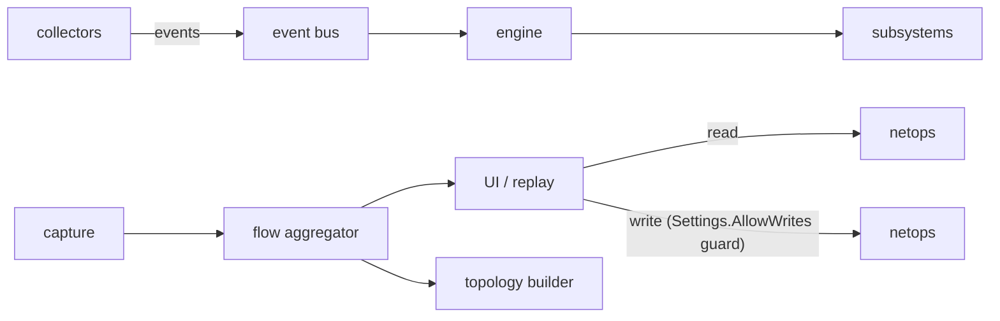

# Testudo - Developer Guide

This document is the engineering counterpart to `README.md`. It targets contributors
who need to build, run, test, and extend Testudo locally.

---

## 1. Prerequisites

| Requirement  | Notes                                                    |
| ------------ | -------------------------------------------------------- |
| Go           | 1.22 or newer                                            |
| Linux kernel | 5.4+ recommended (AF_PACKET, netlink, nftables)          |
| Capabilities | `CAP_NET_RAW`, `CAP_NET_ADMIN` for the binary at runtime |
| Optional     | `iptables` binary for the legacy firewall backend        |
| Optional     | `sqlite3` CLI for ad-hoc inspection of session storage   |

Testudo is developed against Ubuntu and Debian-based systems. Fedora / Arch /
openSUSE are roadmap targets - patches welcome.

---

## 2. Build & Run

```bash
# Build the binary into the repo root.
go build -o testudo ./cmd/testudo

# Run with packet capture enabled (needs CAP_NET_RAW).
sudo setcap cap_net_raw,cap_net_admin=eip ./testudo
./testudo live
```

Common invocations:

```bash
./testudo live                       # TUI, live mode
./testudo sessions                   # list recorded replay sessions
./testudo replay session-YYYY-MM-DD  # open a replay
./testudo ifaces                     # list interfaces
./testudo routes                     # routing table
./testudo nat list                   # NAT and port-forwarding rules
./testudo discover                   # one-shot device scan
./testudo probe <host>               # diagnostic probe
./testudo doctor                     # layered connectivity diagnosis (exit 2 if broken)
./testudo web                        # start the web UI
./testudo user passwd                # change the local password
```

---

## 3. Repository Layout

```text
cmd/testudo/         main + CLI command implementations
internal/
  analyzers/         anomaly detection (latency, loss, jitter, DNS, …)
  auth/              local user / password hashing
  capture/           AF_PACKET capture + Layer-1 ring buffer + PCAP writer
  collectors/        ICMP, DNS, HTTP, TLS, traceroute, WiFi, bufferbloat, tcp_info, … probes
  config/            settings persistence
  discovery/         passive + active device discovery (ARP/ICMP/mDNS/LLDP/SNMP), on-demand nmap, vendor OUI lookup
  doctor/            layered bottom-up connectivity diagnosis (`doctor` CLI command)
  engine/            top-level orchestrator + collector supervision
  events/            in-process event bus
  flows/             flow aggregation + correlation (process, DNS, services)
  health/            per-subsystem status (OK / degraded / failed) + remediation hints
  incidents/         alerting + severity bookkeeping + incident bundles
  integrations/      Guacamole, Sentry, MaxMind GeoIP
  ipfix/             IETF IPFIX (RFC 7011) flow exporter + lifecycle manager
  metrics/           time-series counters (latency, loss, etc.)
  netops/            netlink + nftables + iptables (firewall, route, NAT, iface, conntrack, neigh, dns)
  privsep/           privileged helper, capability dropping, seccomp, FD passing
  probes/            probe runner used by the `probe` CLI command
  quality/           baseline rollup + Network Quality grade
  replay/            replay engine + session storage
  services/          well-known port => service mapping
  storage/           SQLite layer (metrics, sessions, baselines, audit log)
  telemetry/         per-flow TCP telemetry (INET_DIAG, optional eBPF backend)
  topology/          passive topology graph builder
  tui/               Bubbletea TUI
  web/               HTTP server + embedded assets
storage/
  captures/          selective PCAP captures
  metrics/           rolled time-series files
  sessions/          replay sessions (one SQLite db per session)
```

Packages prefixed `internal/` are not importable from outside the module - that's
deliberate. New subsystems should live under `internal/` unless there's a clear
reason to expose an API surface.

---

## 4. Architecture in 60 Seconds



Key invariants:

1. **Packets never hit the event bus.** Capture writes directly into the flow
   aggregator. The bus carries operational signals (anomalies, lifecycle), not
   data-plane volume.
2. **Storage is layered.** Live ring buffer => flow aggregation => metrics in
   SQLite => selective PCAP. Each layer summarises the one above it.
3. **Writes are gated.** Every mutating `netops` call goes through `Writer`,
   which short-circuits to `ErrWritesDisabled` unless `AllowWrites=true`.
4. **Subsystems are isolated.** No subsystem imports another's package
   privately - all cross-talk goes through `events.Bus` or shared types
   (`flows.FlowStats`, `flows.FlowSummary`, `discovery.Device`).

---

## 5. Storage Layers

| Layer                     | Where                            | Lifetime        | Used by                       |
| ------------------------- | -------------------------------- | --------------- | ----------------------------- |
| Layer 1: ring buffer      | RAM (`capture.RingBuffer`)       | seconds         | live render, instant replay   |
| Layer 2: flow aggregation | RAM (`flows.Aggregator`)         | minutes         | TUI, web, anomaly correlation |
| Layer 3: metrics          | SQLite (`storage/metrics/`)      | days–weeks      | dashboards, alerting          |
| Layer 4: PCAP             | filesystem (`storage/captures/`) | incident-scoped | forensics                     |

The persistence-friendly projection of a flow is `flows.FlowSummary` - that's
what replay and the metrics layer serialise. See
[internal/flows/flow.go](internal/flows/flow.go).

---

## 6. Firewall

The packet filter is **the configuration model, rendered into one nftables
table and loaded in one transaction** - see [docs/firewall.md](docs/firewall.md).

* **render** - `internal/fwrender`: the model for one node (policy, zones,
  aliases, filter and NAT rules, access grants, kernel load balancing) as
  the table `inet testudo`. Golden files in `testdata/`.
* **apply** - `internal/fwstage`: the packet-filter stage of the
  transactional apply (`nft -c`, `nft -f`, a generation set to check the
  kernel holds it), the 30 s drift reload and the per-object counters.
  Nothing else writes the table; TUI, Web UI and CLI read it through
  `Engine.FirewallView()`.
* **views** - `internal/netops/firewall.go` decodes *any* nftables ruleset for the
  diagnostic per-rule counter view; `firewall_iptables.go` is a read-only legacy
  fallback that runs `iptables -L -v -n -x`.
* `internal/firewall` only reads an old `firewall.json` for its one-time
  move into the model (`internal/engine/legacyfw.go`).

Real-kernel tests of the ruleset run in a privileged container through
`scripts/netns-tests.sh`.

Privilege separation: the engine drops all capabilities after spawning the helper,
so every nf_tables / conntrack / WireGuard **read** (not just writes) is routed
through the helper's query seam (`netops.Writer` → `Backend.Query`); the privsep
transport chunks large messages across datagrams. New privileged reads must follow
the same pattern - add an `OpQuery*` kind in `netops/backend.go`, a `*Direct`
implementation, and a wrapper that calls `queryInto`.

Identity (users, roles, MFA, TLS) and the actor-bound audit trail are described
in [docs/identity.md](docs/identity.md).
Privileged access (resources, policies, JIT grants, brokers, access log) is
described in [docs/pam.md](docs/pam.md).

---

## 7. Adding a New Subsystem

1. Create `internal/<name>/` with one Go file.
2. If it consumes events: subscribe via `events.Bus.Subscribe`.
3. If it produces events: publish via `events.Bus.Publish`.
4. If it touches the kernel: route through `netops.Writer`.
5. If it needs persistence: add a table in `internal/storage/sqlite.go`.
6. Register it in `internal/engine/engine.go` so the engine can start/stop it.

Don't add a new top-level directory unless the subsystem genuinely doesn't
belong under `internal/`.

---

## 8. Testing

```bash
go test ./...                        # everything
go test -race ./internal/flows/...   # race-detector on the hot path
go vet ./...
```

Integration tests that need raw sockets are skipped unless `TESTUDO_NETTEST=1`
is set - run those manually under sudo on a throwaway VM.

---

## 9. Releasing

The release flow is intentionally minimal:

1. Tag `vX.Y.Z` on `main`.
2. `go build -trimpath -ldflags "-s -w" -o testudo ./cmd/testudo` for each
   target arch.
3. Attach the binaries to the GitHub release.

There is no automated CI release pipeline yet - that's a roadmap item.

---

## 10. Coding Standards

The hot ones:

* No globals.
* `context.Context` everywhere, first arg.
* Channels over mutexes when the data flow is the model.
* Render loops never block.
* No raw packet rendering - always aggregate first.
* Structured logging (we use `slog`).

---

## 11. Where to ask

* Bugs / RFCs: GitHub issues
* Operational questions: README "Operating" section
* Architecture history: this file + `git log internal/<subsystem>/`
