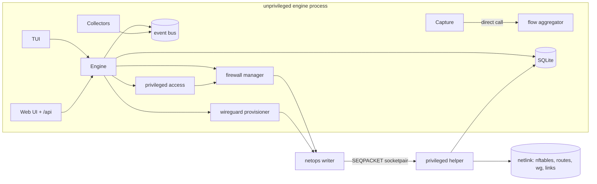
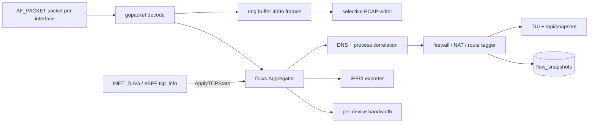

# Architecture: current state

What existed in the repository before the appliance work started; kept as
the reference point it was written as. The firewall manager, `users.json`,
the WireGuard provisioner and in-memory sessions described here were
replaced in Phase 12 ([phase-12-consolidation.md](phase-12-consolidation.md)).
It is the reference point for [GAP-ANALYSIS.md](GAP-ANALYSIS.md). Line
references are to the tree at commit `b80d362`.

## 1. Shape of the system

Testudo is one Go binary (`cmd/testudo`, module `github.com/noahzmr/testudo`,
Go 1.25, pure Go, no cgo). About 47k lines of non-test Go in 33 packages under
`internal/`. Licensed MPL-2.0.

### Entry points

Hand-written `switch` over `os.Args` with one stdlib `flag.FlagSet` per
subcommand (`cmd/testudo/main.go:60-94`): `live` (default, TUI), `web`,
`sessions`, `replay`, `ifaces`, `nat`, `firewall`, `routes`, `user`,
`discover`, `probe`, `doctor`, `version`. There is no daemon mode separate
from `web`, no systemd unit, no packaging.

### Process model

The binary re-executes itself as `testudo __helper`
(`internal/privsep/spawn_linux.go`). Engine and helper talk over an anonymous
`AF_UNIX SOCK_SEQPACKET` socketpair on fd 3: one opcode byte plus an opaque
body, 64 KiB frames with continuation, 64 MiB per message
(`internal/privsep/protocol.go`). Opcodes: Ping, Mutate, OpenSocket (fd
returned through `SCM_RIGHTS`), CaptureStart/Stop/Status, Query. The helper
accepts only the parent's uid (`SO_PEERCRED`). After the spawn the engine sets
`NO_NEW_PRIVS` and empties its capability sets. The helper installs a seccomp
deny-list. If the spawn fails the engine falls back to an in-process writer.

The write gate (`--allow-netops-write`, or the persisted setting) is enforced
on the engine side in `netops.Writer`; the helper itself always allows writes.

### Engine and event bus

`engine.New` builds the bus, supervisor, metric and flow aggregators, DNS
cache, packet ring buffer, device inventory and the firewall manager.
`Start` launches roughly twenty supervised goroutine subsystems (panic
recovery, restart back-off, `KindSubsystemDegraded` events).

The bus (`internal/events/events.go`) is an in-process fan-out with 21 event
kinds. Publishing never blocks; a slow subscriber loses events silently and
there is no drop counter. Packets never travel on the bus.

## 2. Flow analysis (the part that must keep working)

* **Capture** (`internal/capture/capture.go`): one `pcapgo` AF_PACKET handle
  and goroutine per interface; no libpcap. Interfaces are discovered once at
  start (up, has an address, not `lo`, not `veth*`); hot-plugged interfaces
  are not picked up. Interfaces without a hardware address (wg, tun, ppp) are
  decoded from the IP header. Only TCP and UDP produce flows; ICMP and other
  protocols are dropped in `decode`. The byte count is the full frame length,
  including the Ethernet header.
* **Flow table** (`internal/flows/flow.go`): a mutex-guarded map of at most
  4096 flows, least-recently-seen evicted. The key is `(interface, endpoint A,
  endpoint B, protocol)` with the endpoints ordered lexicographically **as
  strings**, so one conversation is one bidirectional entry per interface it
  crosses. Counters: packets, bytes, bytes A→B, bytes B→A, first and last
  seen. There is no flow expiry other than eviction, and no notion of which
  side initiated.
* **Enrichment**: DNS name and owning process (`correlate.go`), service name,
  per-flow TCP RTT/retransmits joined from `tcp_info`
  (`internal/collectors/tcpinfo.go`), and firewall chain / NAT mapping /
  route tags from the engine's tagger. NAT is a string tag; pre- and post-NAT
  addresses are not modelled, so a NATed conversation appears as two
  unrelated flows on two interfaces.
* **Conntrack** is polled for a separate view and for table-fill alerts
  (`collectors/l3.go`); it is not a flow source.
* **Persistence**: `flow_snapshots` rows on a timer, capped by row count
  (`engine/quality.go`, `storage/rollup.go`); a `flows` table keyed per
  session. Retention is by row cap, not by documented time policy.
* **Export**: IPFIX over UDP from the same aggregator (`internal/ipfix`).

Before this document there were no tests for capture, the flow table, the
roll-ups or IPFIX; only the DNS cache had tests.

## 3. Firewall and NAT

`internal/firewall` (policy and manager) over `internal/netops` (netlink).

* **Model**: `Policy{Version, UpdatedAt, Enforce, Baseline, Rules, Forwards,
  Masquerades}`. A `FilterRule` has chain, action, protocol, port or range,
  in/out interface, source/destination CIDR, conntrack state, log, rate
  limit, comment and owner. Rule identity is a 12-hex-digit SHA-256 **content
  hash**, so editing a rule changes its ID. Owners: `user`, `baseline`,
  `wg-peer:<pubkey>`, `pam-grant:<id>`.
* **Storage**: `<storage>/firewall.json`, mode 0600, written through a
  temporary file and rename.
* **Apply**: validate → write gate → frame-size check → rebuild the whole
  `inet testudo_filter` table (and `ip testudo_nat`) in one atomic netlink
  batch → persist. A failed NAT apply rolls the filter table back on a
  best-effort basis. A failed persist is only logged.
* **Commit-confirm** exists for exactly one operation, switching default-deny
  on. The timer is an in-memory `time.AfterFunc` (60 s CLI/TUI, 90 s Web);
  the enforced policy is already on disk when the timer starts, so a crash
  inside the window comes back enforced. No other rule change is guarded.
* **Drift**: every 30 s the manager compares chain policies and ordered rule
  IDs with the kernel and re-applies when writes are allowed.
* **Present**: IPv4 and IPv6 CIDRs (one family per rule), port ranges,
  conntrack state, rate limits, per-rule logging, reject, counters, JSON
  export/import, an nft-style text rendering for display.
* **Absent**: zones, aliases and named sets, GeoIP matching, interface
  groups, anti-spoofing, SYN-flood guard, SNAT to an address, 1:1 NAT, NAT
  reflection, any IPv6 NAT, an output-chain policy other than accept, golden
  files, an `nft -c` dry run.

## 4. Routing and interfaces

`netops/route.go` adds and deletes static routes in the main table through
netlink and lists all tables. There are no policy rules, VRFs, multipath
routes, gateway monitoring, multi-WAN logic or routing daemon integration.
Routes are runtime-only. IP forwarding is not managed.

Interfaces: up/down, addresses, MTU, txqlen. DHCP shells out to `dhclient` or
`dhcpcd`; DNS rewrites `/etc/resolv.conf`. Persistence exists only through a
netplan editor with a backup/generate/apply/restore sequence.

## 5. WireGuard

`internal/wireguard` over `wgctrl` (kernel WireGuard through generic netlink).

* Monitoring of devices and peers, handshake-age anomalies, throughput
  history, replayable samples (public keys only).
* Provisioning is a transaction with an undo stack: key pair, IPAM (IPv4,
  next free address), peer configuration, route, firewall preset (full, split,
  isolated) owned by `wg-peer:<pubkey>`, optional masquerade, one-shot client
  configuration. Update and deprovision are best-effort without rollback.
* Persistence is netplan YAML plus `wg_peer_meta` / `wg_iface_meta` rows.
* **Absent**: preshared keys, key rotation, peer expiry, IPv6 inside the
  tunnel, provisioning on more than the single configured device, a
  site-to-site model, a firewall zone per tunnel.

## 6. Identity and privileged access

* **Users** (`internal/auth`): `users.json` (0600), bcrypt, roles viewer <
  approver < operator < admin, in-house TOTP. No API tokens, no OIDC, no
  LDAP, no Linux-PAM integration.
* **Privileged access** (`internal/pam`; the package name means privileged
  access management, not Linux-PAM): resources, policies, just-in-time grants
  compiled into `pam-grant:<id>` firewall rules for the requester's WireGuard
  peers, break-glass (admin, at most 4 h), brokered ssh/rdp through Guacamole,
  an SSH user CA (`internal/sshca`), and a hash-chained `access_events` log.
* **Web sessions** are an in-memory map (lost on restart), cookie
  `testudo_sid`, 8 h. The role is checked per URL path prefix in one
  middleware (`web.go:330-370`), not per object. CSRF defence is an
  Origin / `Sec-Fetch-Site` check without tokens.

## 7. Web UI and API

`net/http.ServeMux` with 80 exact-path `/api/*` routes and no method routing.
The UI is about 3200 lines of vanilla JavaScript embedded with `go:embed`;
there is no framework and no build step. It polls `/api/snapshot` every two
seconds; there is no SSE or WebSocket. The API has no specification, no
versioning, no ETag / If-Match and no optimistic concurrency. TLS uses an
operator certificate or a generated self-signed one.

## 8. Configuration and persistence

| File (below `~/.testudo`) | Format | Notes |
| --- | --- | --- |
| `testudo.db` | SQLite (WAL) | 21 tables; `CREATE TABLE IF NOT EXISTS` plus ad-hoc `ALTER` probes, no schema version |
| `settings.json` | JSON, 0600 | thresholds and integration settings, including third-party credentials in plain text |
| `users.json` | JSON, 0600 | users, bcrypt hashes, TOTP secrets |
| `firewall.json` | JSON, 0600 | firewall and NAT policy |
| `tls/`, `sshca/` | PEM / OpenSSH | private keys 0600 |

`config.Config` is code defaults overridden by flags; there is no
configuration file. Structs carry `json` tags only (snake_case). There are no
`validate` or `ui` tags, no validator library, no generated code, no UUIDs.

The audit log row is `(ts, op, args JSON, peer_uid, actor, result)`; it has
no before/after state.

## 9. Tests and automation

* 23 packages have tests; all pass (`go build`, `go vet`, `go test ./...`
  clean at `b80d362`).
* Four real-kernel nftables tests re-execute under `unshare -Urn`. On hosts
  that restrict unprivileged user namespaces (the Ubuntu default with
  `kernel.apparmor_restrict_unprivileged_userns=1`) they **skip silently**, so
  a green run does not prove the kernel path was exercised.
* No CI, no Makefile, no linter configuration, no release tooling.

## 10. Things noticed that do not match

Recorded, not fixed here.

1. `docs/architecture.md` describes one database per session; the code uses a
   single `testudo.db`.
2. `docs/wireguard.md` calls provisioning roadmap, says it runs entirely in
   the helper, and names the marker `testudo-wg-peer-<id>`; the code
   provisions from the engine and uses the owner `wg-peer:<pubkey>`.
3. `docs/identity.md` lists fewer admin-only paths than the middleware
   enforces.
4. `DEVELOPER.md` mentions a `TESTUDO_NETTEST` variable that no code reads.
5. Web commit-confirm is 90 s, CLI and TUI are 60 s.
6. The helper launches `tcpdump` with `exec.Command` while its seccomp
   deny-list contains `execve`; the filter is installed without thread
   synchronisation, so it may only cover one OS thread. Needs a dedicated
   look before the helper is trusted with more operations.
7. An untracked scratch test, `internal/privsep/zz_skeptic_tmp_linux_test.go`,
   sits in the working tree.
